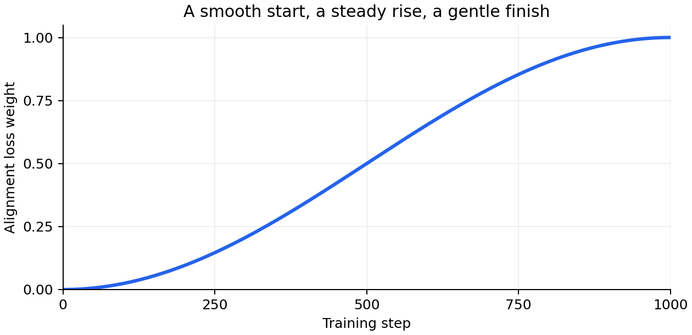

# RunWeaver ML

**Build the training workflow you need. Keep the framework out of your research decisions.**

RunWeaver ML is a lightweight, model-agnostic Python framework for experimental machine learning. It separates two recurring engineering problems from the experiments themselves:

## Dataset Management (DSM)

Change your data source without rebuilding your processing pipeline. RunWeaver’s Dataset Management System separates transport from processing through independent, interchangeable layers, drawing on the separation of concerns used in protocol stacks.

Switch between TAR archives, memory, or your own transport implementation without changing the processing pipeline. Load samples, prepare the data your model needs, combine datasets, and deliver training batches.

## Phase Control

RunWeaver's Phase Control system organizes training into distinct phases, each with its own objectives, trainable components, and execution settings. Your application controls the transitions between phases; RunWeaver coordinates training and validation within each prepared phase and provides a consistent execution framework for experiments that require different training strategies at different stages.

The application retains control over its models, optimizers, and experiment-specific behavior.

### Scheduling Engine

RunWeaver's Scheduling Engine makes experimental intent explicit: parameters can evolve throughout training without burying that behavior in custom loop code. Linear ramps, smooth cosine transitions, gates, and periodic switches provide a compact vocabulary for designing experiments.

Gradually increase an alignment objective’s weight, activate an auxiliary loss during a chosen window, or alternate experimental settings—all through scheduled parameters. Each scheduled value follows directly from its configuration and the supplied training step, making changing training strategies predictable, easy to inspect, explain, and reproduce.

> **The Scheduling Engine isn't just a convenience for changing learning rates or loss weights. It makes complex training strategies practical.**

**Use either subsystem independently, or combine them.** RunWeaver supplies the infrastructure; your application decides what to train and how.

## Why RunWeaver?

Research experiments change constantly. Datasets grow, storage formats change, training objectives evolve, and different stages of training demand different behavior. Rewriting data pipelines and training loops for each new idea slows down the research itself.

RunWeaver keeps those concerns separate. **Change the transport without rewriting sample processing. Change the training strategy without rewriting the loop.**

### How the pieces fit

```text
                         Your research application
                        /                         \
                       v                           v
              PHASE CONTROL                  DATASET MANAGEMENT
           phases · schedules             transport · decoding
           trainers · objectives          providers · artifacts · prefetch
           train/validate loops           mixing · collator · DataLoader
                       \                           /
                        \____ optional integration _/
```

Phase Control accepts loaders from your application, whether or not they use DSM. DSM supplies batches to your training code, whether or not you use Phase Control. Neither subsystem dictates your model, experiment configuration, or storage format.

### A few useful terms

| Term | Meaning |
| --- | --- |
| **Transport** | The protocol layer that delivers samples from storage, memory, or another source, independently of the processing pipeline. |
| **Provider** | A component that processes samples, optionally adding, modifying, or filtering their data. |
| **Artifact** | A value or callable object that generates values, made available to dataset processing components. |
| **Collator** | Combines individual samples into a batch your training code can use. |
| **Phase** | One stage of training, with its own settings and objectives. |

RunWeaver's transport architecture follows the separation of concerns used in network protocol stacks. Processing components need not know whether their samples came from TAR archives, memory, or a custom transport. The included TAR and memory transports demonstrate the interface; other sources can be integrated by implementing the transport contract.

RunWeaver began as infrastructure extracted from a research application. It remains an evolving `0.1.x` library, not a turnkey experiment runner or a frozen public API.

## Install

Requires **Python 3.10+**. Declared dependencies include PyTorch, NumPy, SciPy, and WebDataset.

```bash
git clone https://github.com/Gogie607/RunWeaver-ML.git
cd RunWeaver-ML
python -m pip install -e .
```

For a non-editable local installation, use `python -m pip install .`.

## Quick start: data without TAR files

The simplest demonstration uses `MemoryTransport`, which delivers native Python values through the same DSM pipeline as a storage-backed dataset.

```python
from runweaver_ml.dataset_management import (
    MemoryTransport,
    MultimodalDataset,
    create_loader,
)

transport = MemoryTransport([
    {"__key__": "a", "text": "hello", "label": 1},
    {"__key__": "b", "text": "world", "label": 0},
])

dataset = MultimodalDataset(
    transport=transport,
    domain="demo",
    requires=["text", "label"],
)

loader = create_loader(dataset, ["text", "label"], batch_size=2)

for batch in loader:
    print(batch["sample_id"], batch["text"], batch["label"])
```

No archive files or special directory layout are needed. The transport supplies samples; RunWeaver handles the downstream pipeline.

For a custom transport, implement the public `TransportBase` contract and supply it to `MultimodalDataset` the same way. See [Transport extensions](docs/TRANSPORT_EXTENSIONS.md).

### Add processing through configuration

Keep the same `transport` from the quick start. An application-defined provider
can append a word to each sample without changing the transport or consuming loop:

```python
from runweaver_ml.dataset_management import build_datasets
from runweaver_ml.dataset_management.source import ProviderBase


class AppendWordProvider(ProviderBase):
    provider_name = "readme_append_word"
    requires = ["text"]
    capabilities = ["text"]

    def __init__(self, word):
        super().__init__()
        self.word = word

    def process(self, sample, view):
        sample["text"] = f"{sample['text']} {self.word}"
        return sample


config = {
    "requires": ["text", "label"],
    "providers": [
        {"name": "readme_append_word", "config": {"word": "RunWeaver"}},
    ],
    "datasets": [{"name": "demo", "transport": transport}],
}

dataset = build_datasets(config)
loader = create_loader(dataset, config["requires"], batch_size=2)

for batch in loader:
    print(batch)
```

The resulting text is `hello RunWeaver` and `world RunWeaver`. Change `word` to
change the output; remove the `providers` entry and rebuild to restore `hello`
and `world`. The transport, loader construction, and print-only loop stay the same.

Defining or importing the provider class registers it with DSM's existing
mechanism. `build_datasets()` passes the configuration to `build_dataset()`, which
constructs and installs a separate provider for each dataset. The application
never instantiates or calls the provider itself.

Run [the complete demonstration](scripts/demo_memory_provider.py) to see both
configured and original samples using the same transport:

```bash
python scripts/demo_memory_provider.py
python scripts/demo_memory_provider.py --word research
```

## Dataset Management: storage is only the beginning

```text
TAR / Memory / your TransportBase implementation
                     |
                     v
              LayoutSource
           decoding · identity
                     |
                     v
               DatasetView
           providers · artifacts
                     |
                     v
             threaded prefetch
                     |
                     v
          MultiDatasetManager
           per-domain or mixed
                     |
                     v
          DynamicCollator / DataLoader
```

Each `MultimodalDataset` has **one transport**. `MultiDatasetManager` can combine multiple datasets, including datasets backed by different transports.

Transports supply samples, providers can enrich or filter them, and the collator builds batches. Artifacts supply dataset-level values to components that need them. The storage format is up to the application.

Each sample needs a stable identifier (`__key__`). Other transport-specific identifiers are optional. See [Transport extensions](docs/TRANSPORT_EXTENSIONS.md) for the detailed contract.

### TAR remains a first-class option

For datasets stored in TAR archives, the included `TarTransport` can combine matching sample entries from separate modality archives.

```text
datasets/example/
├── text/
│   ├── 000.tar      # a.text.txt, b.text.txt, ...
│   └── 001.tar
└── embedding/
    ├── 000.tar      # a.embedding.npy, b.embedding.npy, ...
    └── 001.tar
```

When combining these archives, their filenames and sample identifiers must correspond.

A configuration-driven loader is available:

```python
from runweaver_ml.dataset_management import build_dataset_and_loader

config = {
    "batch_size": 8,
    "requires": ["text", "embedding"],
    "lazy": ["embedding"],
    "iteration_policy": {
        "mix_mode": "per_domain",
        "exhaust_policy": "finite",
    },
    "datasets": [
        {
            "name": "example",
            "root": "datasets/example",
            "bias": 1.0,
            "prefetch_workers": 1,
        }
    ],
}

loader = build_dataset_and_loader(config)
for batch in loader:
    print(batch["sample_id"], batch["text"])
```

In mixed mode, dataset selection weights are proportional to `sqrt(num_samples) * bias`. Exhaustion policies include finite traversal and looping options.

**Large payloads need not be loaded all at once.** Eligible TAR payloads load on demand, and sample counting avoids decoding those payloads just to determine dataset size. This reduces unnecessary loading and memory use. See [Transport extensions](docs/TRANSPORT_EXTENSIONS.md) for resource ownership and cleanup details.

A sample batch always includes `sample_id` and `domain`; optional storage identifiers are included only when supplied. Numeric values can become tensors, arrays are stacked where appropriate, and variable-length WAV values remain lists.

## Phase Control: structure without prescribing the experiment

Phase Control describes *when and how training behavior changes*, while the host application decides *what is being trained*.

```text
Optional PhaseManager -> PhaseContext
                     |
                     v
           application assembles
           targets + schedules
                     |
                     v
       ParameterWrapper / ScheduleEngine
                     |
                     v
       TrainingModule + TrainerBase
                     |
                     v
       PhaseOrchestrator.train_epoch()
         optimization · validation
         logging hooks · checkpoints
```

A phase carries a name, enabled state, run settings, targets, and schedules. The application assembles each phase's model, optimizer, loaders, and training module.

`TrainerBase` provides a small computation contract:

```python
compute(batch, params)  # -> (loss, payload)
train_context()         # context manager
eval_context()          # context manager
```

`TrainingModule` connects that contract to loop hooks and scheduled parameters. `ObjectiveComposer` is available when an experiment benefits from combining multiple `TrainingObjective` implementations around a shared `TrainingContext`; it is optional.

### Try a scheduled experimental parameter

Smoothly increase an alignment loss weight from zero to one over the first 1,000 steps with a cosine schedule:

```python
from runweaver_ml.phase_control import (
    ParameterWrapper,
    ParamProvider,
    ScheduleEngine,
    TargetRegistry,
    build_schedule_block,
)

registry = TargetRegistry({"alignment_weight": 0.0})
engine = ScheduleEngine(registry)
engine.register("alignment_weight", build_schedule_block({
    "type": "cosine",
    "start": 0.0,
    "end": 1.0,
    "start_step": 0,
    "end_step": 1_000,
}))
params = ParameterWrapper(
    engine,
    ParamProvider(run={}, global_cfg={}, runtime={}, registry=registry),
)

for step in (0, 250, 500, 1_000):
    params.step(step)
    print(step, f'{params.get("alignment_weight"):.3f}')
# 0 0.000
# 250 0.146
# 500 0.500
# 1000 1.000
```



The curve is generated from RunWeaver itself. To reproduce it with Matplotlib
available, run `python scripts/plot_readme_schedule.py` from the repository root.

In training, pass this parameter wrapper to `TrainingModule`; it advances the
schedule before each training computation. Your trainer reads
`params.get("alignment_weight")` to weight its loss. Construct fresh scheduling
objects for each phase. The same mechanism supports cosine transitions, threshold
switches, gates, and periodic square waves.

A configured loop can be invoked directly:

```python
from runweaver_ml.phase_control import PhaseOrchestrator, TrainLoopConfig

loop_config = TrainLoopConfig.from_config(
    {
        "schedule": {
            "log_every": 10,
            "validate_every": 100,
            "validate_max_steps": 20,
            "save_every": 500,
        },
        "amp": {
            "enabled": True,
            "dtype": "float16",
            "grad_scaler": True,
        },
        "gradient_accumulation": {
            "enabled": True,
            "count": 4,
        },
    },
    max_steps=1_000,
)

final_step = PhaseOrchestrator.train_epoch(
    trainer=training_module,
    loop_config=loop_config,
    optimizer=optimizer,
    train_loader=train_loader,
    val_loader=validation_loader,
    logger=logger,
)
```

The example assumes your application has constructed `training_module`, `optimizer`, and the loaders. RunWeaver does **not** construct a complete training run from YAML, choose model architectures, or impose checkpoint storage.

Gradient accumulation is disabled when the section or `enabled` is missing.
When enabled, `count` is required and must be a positive integer. It works with
both float16 AMP (including GradScaler) and bfloat16 AMP. For example, physical
batch size 1 with `count: 4` gives an effective batch of 4 samples for full groups.
Do not wrap the loop in another accumulation mechanism.

Step limits, returned steps, parameter schedules, logging and validation still
count consumed batches. The optimizer and optional learning-rate scheduler
advance once per accumulation group; AMP overflow skips both updates. Batch losses
are averaged with equal weight, and a final incomplete group is normalized by
its actual batch count and applied on normal completion. An exception discards
pending gradients. Checkpoint requests inside a group are coalesced and deferred
to its update boundary, including a final incomplete group. Validation keeps its
batch-based cadence and sees the latest completed update. Accumulation state is
local to this loop invocation and is not carried between phases.

## Extension points

RunWeaver is intended to be extended by composition, not by copying the framework.

- **Storage:** supply a `TransportBase` implementation and a modality manifest. Native values are supported.
- **Sample processing:** install application-defined providers and artifacts.
- **Training behavior:** implement a trainer, objectives, model wrapper, and hooks as needed.
- **Configuration:** construct objects in Python or translate your own YAML/configuration into the supported dictionaries. RunWeaver itself does not load YAML.

Provider requirements are checked against the data available in the pipeline. Details of optional storage identifiers belong in the [transport documentation](docs/TRANSPORT_EXTENSIONS.md).

## Documentation

- [Architecture](ARCHITECTURE.md): subsystem boundaries, data flow, ownership, extension contracts, and limitations.
- [Architectural decisions](docs/ARCHITECTURAL_DECISIONS.md): design intentions, historical compromises, and review principles.
- [Transport extensions](docs/TRANSPORT_EXTENSIONS.md): the concrete public transport contract, lazy payload lifecycle, and examples.
- [TODO](TODO.md): tracked work and known discrepancies.

## Development

```bash
python -m unittest discover -s tests -v
```

The suite covers TAR behavior, transport extension cases, sample processing, resource cleanup, and metadata counting. Additional phase-control integration coverage remains a development priority.

## Scope and status

RunWeaver ML is **research infrastructure**, not an all-in-one training platform. Application-level run assembly, model and optimizer creation, concrete provider implementations, logger integration, and checkpoint destinations remain application responsibilities.

The library is currently at **0.1.x**, and its APIs may change as the framework matures. Contributions should preserve the one-way dependency: applications import RunWeaver, never the reverse.

Licensed under **GPL-3.0-or-later**. See [LICENSE](LICENSE).
